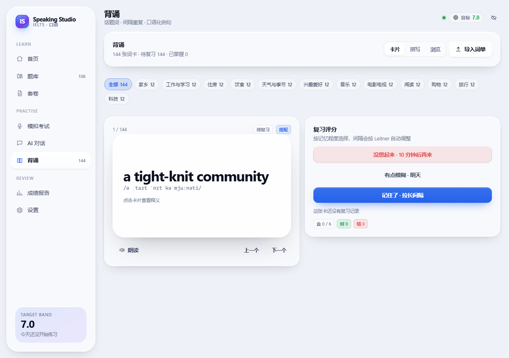
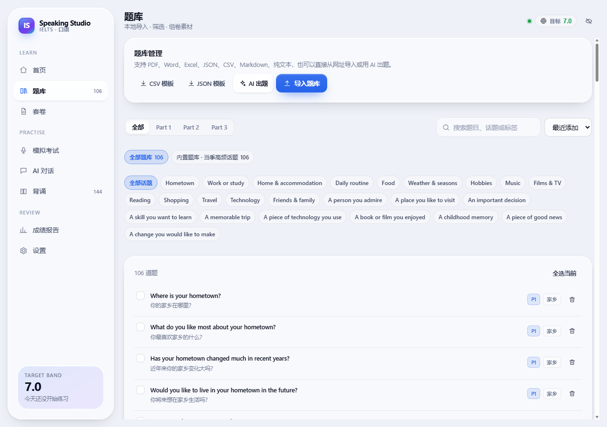
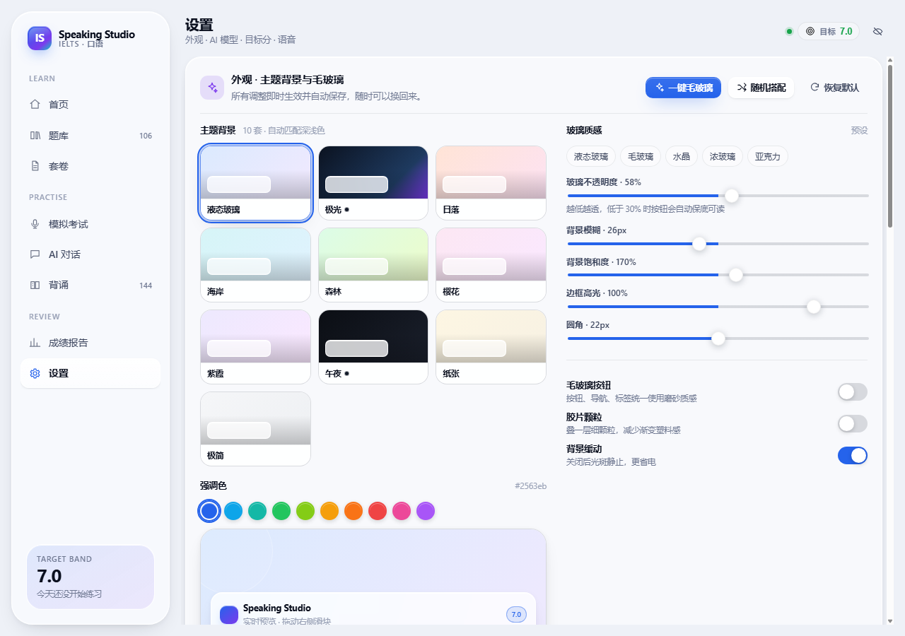

# IELTS Speaking Studio · 雅思口语工作台

[](https://github.com/kokosuki666/ielts-speaking-app-by-deepseek/actions/workflows/ci.yml)
[](LICENSE)

一个完全本地运行的雅思口语学习与练习 Web App：**导入口语题库 → 自由组卷 → 限时模考 → AI 考官打分 → 话题词背诵**，形成完整训练闭环。


界面采用「液态玻璃」风格（Apple 式排版 + 毛玻璃层次 + 柔和网格渐变），内置 **10 套主题背景**与可调节的毛玻璃参数，支持深色模式与移动端底部导航。


---

## 功能

### 0. 外观与主题（设置 → 外观）

- **10 套主题背景**：液态玻璃、极光、日落、海岸、森林、樱花、紫霞、午夜、纸张、极简；切换时自动匹配浅色 / 深色
- **强调色**：10 个精选色，按钮、进度条、图表同步变化
- **毛玻璃参数**（实时生效、自动保存）：不透明度 12%–96%、模糊 0–60px、饱和度 80%–240%、边框高光 0–120%、圆角 8–36px
- **5 个质感预设**：液态玻璃 / 毛玻璃 / 水晶 / 浓玻璃 / 亚克力
- **开关**：毛玻璃按钮、胶片颗粒、背景缓动
- **实时预览卡片** + 一键毛玻璃 / 随机搭配 / 恢复默认

### 1. 本地题库与组卷

- 从本地导入 **PDF、Word(.docx)、Excel(.xlsx/.xls)、JSON、CSV、TSV、TXT、Markdown、HTML**，拖拽即可
- **从网址导入**：粘贴一个题库整理页 / 博客列表的 URL，抓取正文并识别题目
- **AI 出题**：按话题、Part、难度生成原创雅思风格题目，预览后作为一个新题库加入
- 文档在本地服务里提取文字，再用结构识别转成题目：识别 `Part 1/2/3`、话题标题、`Describe ...` 题卡与提示点、问句、中文翻译
- 自动识别字段别名（`question / prompt / 题目`、`topic / 话题`、`bullets / cue_points / 提示` 等）；支持 Excel 导出的 GBK 编码 CSV
- 按 Part、话题、标签、关键词筛选；勾选题目即可组卷
- 套卷结构 = Part 1 问答 + Part 2 Cue card + Part 3 讨论，自动估算时长
- 随机生成套卷（可设 Part 1 / Part 3 题量与话题范围）、复制、编辑、导出 JSON
- 内置一份当季高频题库：**106 道题，24 个话题**（14 个 Part 1 话题 × 4 题、10 张 cue card、40 道 Part 3）

### 2. AI 考官与评分系统

- 按雅思官方四项标准评分：**流利度与连贯性 / 词汇多样性 / 语法多样性与准确性 / 发音**
- 0.5 分步进；总分严格按官方规则取四项均值后四舍五入到 0.5
- 每项给出：分数、总评、优点、待改进、**逐句证据**（引用你的原话）+ 具体改法
- 可设置目标分数；报告自动计算分差，并给出：
  - 3 个按提分效率排序的训练重点 + 可执行动作
  - 目标分水平的高分示范改写（可朗读跟读）
  - 3–8 周的周计划
  - 这次最该背的话题词（一键加入背诵）
- 支持随时取消评分；AI 失败时自动降级到离线估算

**离线估算引擎（无需 API Key）**：基于语速（wpm）、填充词比例、实词多样性、复杂从句密度、句长分布、重复片段、高分表达命中率等可解释指标，给出偏保守的下限估计（±0.5 参考区间），并在报告中标注依据。

### 3. AI 对话

- 6 个日常场景（咖啡店闲聊、周末旅行、电影、工作、美食、科技）+ 任意自定义话题
- 也可切到「考官模式」，由 AI 按 Part 1 → Part 3 的梯度提问
- 流式回复、逐句朗读（TTS）、麦克风输入
- 结束对话后自动复盘：
  - 你说得好的表达（引用原句）
  - 2–4 条「你说 → 更地道」的改写与原因
  - **10–12 个口语化话题词**（含习语与话语标记），一键加入背诵

### 4. 背诵

- 内置 **12 个话题 × 12 条 = 144 张词卡**，全部为口语化表达（搭配 / 习语 / 短语 / 话语标记），含 IPA、中文释义、口语例句与译文
- **导入自己的词单**：PDF / Word / Excel / CSV / JSON / TXT / Markdown / HTML，也可以直接粘贴、粘贴网址或手动逐条添加；导入后作为一个独立词单出现在话题列表里，可整单删除
- 三种模式：翻转卡片复习、拼写自测（看中文写英文 + 例句挖空）、浏览词库
- 间隔重复（Leitner 5 盒，答对后间隔 1 → 2 → 4 → 7 → 15 → 30 天）
- 可基于题库话题用 AI 生成更多话题词，或从对话复盘 / 模考报告导入
- 掌握度、到期数量、今日复习统计

### 5. 其他

- 首页：目标分进度、练习热力图（12 周）、分数趋势、最近成绩、下一步建议
- 全部数据存于浏览器 `localStorage`，支持整库导出 / 导入备份
- 打印样式：成绩报告可直接打印或另存 PDF

---

## 快速开始

需要 Node.js ≥ 18（开发时使用 Node 24 验证）。

```bash
cd ielts-speaking-webapp
npm install
npm run dev
```

打开终端里 Vite 输出的地址（默认 <http://localhost:5199>）。`npm run dev` 会同时启动：

- 前端 Vite 开发服务器（配置里优先 5199，被占用时会自动换端口，以终端输出为准）
- 本地服务（<http://127.0.0.1:8787>）：AI 代理、文档解析（PDF / Word / Excel）、静态服务；前端通过 `/api` 代理访问

> PDF / Word / Excel 的导入依赖本地服务。只把 `dist/` 当纯静态页打开时，JSON / CSV / TXT 仍可导入，但不支持文档格式。

### 生产模式

```bash
npm run build
npm start          # 同一个端口同时提供静态页面与 /api，默认 http://127.0.0.1:8787
```

### 桌面版（Electron）

```bash
npm run desktop:dev     # 构建前端 + 用 Electron 打开
npm run desktop:build   # 构建 + 生成 Windows 安装包与便携版（输出到 release/）
```

产物：

- `release/IELTS Speaking Studio-Setup-1.4.0.exe`（NSIS 安装包）
- `release/IELTS Speaking Studio-1.4.0-portable.exe`（免安装）
- `release/win-unpacked/`（解包目录，便于排查）

桌面版主进程是 `electron/main.cjs`：启动时用当前 Node 拉起 `server/index.mjs`（端口 47119），再用窗口加载 `http://127.0.0.1:47119`，因此文档解析、AI 代理、神经语音全部可用，不依赖外部服务。

打包注意：

- 首次打包需要下载 Electron 与 NSIS 工具链；国内网络可设置镜像：
  `ELECTRON_MIRROR=https://npmmirror.com/mirrors/electron/`、
  `ELECTRON_BUILDER_BINARIES_MIRROR=https://npmmirror.com/mirrors/electron-builder-binaries/`
- 缓存默认写入 `%LOCALAPPDATA%\electron-builder`，若被安全软件拦截，可设置 `ELECTRON_BUILDER_CACHE=<项目内目录>`
- 未配置代码签名证书时会跳过签名（`electron-builder.yml` 里已显式关闭），Windows 可能提示"未知发布者"
- `electron-updater` 必须在 `dependencies` 里，否则打包后主进程会因找不到模块而闪退

### 源码备份

```bash
npm run backup            # 生成 git bundle 到 ..\ielts-speaking-backups
npm run backup -- D:\bak  # 指定目录
```

仓库已用 git 管理；建议每次改完提交一次，并定期把 bundle 放到另一块盘或网盘。

---

## 配置 AI

**项目里没有任何内置 Key，也不锁定模型。** 默认值只是把 DeepSeek 的地址和模型名填好，Key 留空——用不用、用哪家、花谁的钱，完全由你决定。

### 调用链

```
浏览器 (React) ──POST /api/ai/chat──▶ 本地服务 server/index.mjs ──▶ 你配置的 OpenAI 兼容接口 /chat/completions
```

- 前端只把「Base URL / 模型名 / 温度 / Key」和对话内容发给本地服务，从不直连模型：绕开 CORS，Key 也不会进入打包产物
- 本地服务按 OpenAI 规范转发；流式响应在服务端解析 SSE，再把纯文本分块转给前端
- 需要结构化输出的请求（评分报告、对话复盘、生成词条）会带 `response_format: json_object`；如果某个模型或网关不支持这个参数，服务端会**自动去掉它重试一次**，仍失败再**去掉 temperature** 重试，兼容性更好
- Key 解析顺序：设置页填的 Key → 同一提供商的 `.env` Key（仅当 Base URL 完全一致）→ 本地地址免 Key

### 换成任何模型

「设置 → AI 模型」里改三项即可，**保存后立即生效，不用重启**：

| 提供商 | Base URL | 模型名示例 |
| --- | --- | --- |
| DeepSeek | `https://api.deepseek.com/v1` | `deepseek-chat`、`deepseek-reasoner` |
| OpenAI | `https://api.openai.com/v1` | `gpt-4o-mini`、`gpt-4o` |
| Moonshot | `https://api.moonshot.cn/v1` | `moonshot-v1-8k` |
| 通义千问（兼容模式） | `https://dashscope.aliyuncs.com/compatible-mode/v1` | `qwen-plus` |
| 智谱 GLM | `https://open.bigmodel.cn/api/paas/v4` | `glm-4-flash` |
| SiliconFlow | `https://api.siliconflow.cn/v1` | `Qwen/Qwen2.5-7B-Instruct` |
| OpenRouter | `https://openrouter.ai/api/v1` | 任意模型 ID |
| 本机 Ollama | `http://127.0.0.1:11434/v1` | `qwen2.5:7b` |
| LM Studio / vLLM | `http://127.0.0.1:1234/v1` | 本地加载的模型名 |

本地地址（`localhost` / `127.0.0.1` / `0.0.0.0` / `host.docker.internal`）**可以不填 Key**，服务端会自动不带 `Authorization` 头。

### 三种存放 Key 的方式

1. **网站内设置**（推荐）：右上角「设置 → AI 模型」，填完点「测试连接」。Key 只存在本机浏览器 `localStorage`，不会上传到本项目的任何服务。
2. **`.env` 文件**：复制 `.env.example` 为 `.env` 并填写，服务端会读取：

   ```ini
   IELTS_AI_BASE_URL=https://api.deepseek.com/v1
   IELTS_AI_API_KEY=sk-xxxx
   IELTS_AI_MODEL=deepseek-chat
   ```

   然后在设置里打开「服务端密钥」，浏览器就完全不需要保存 Key（适合共用电脑）。

3. **环境变量**：直接设置 `IELTS_AI_BASE_URL / IELTS_AI_API_KEY / IELTS_AI_MODEL / PORT`。

> 为什么需要本地代理？浏览器直连大模型接口会被 CORS 拦截，而且把 Key 打进前端产物不安全。代理只有 `server/index.mjs` 一个文件。

### 哪些功能会调用模型

| 用 AI | 纯本地（无 Key 也能用） |
| --- | --- |
| 模考评分与报告（四项分数、证据、提分路径、示范答案） | 题库导入 / 组卷 / 模考录音与计时 |
| AI 对话、结束后的复盘与话题词 | 背诵（内置 144 张词卡 + 间隔重复） |
| AI 生成话题词条 | 离线估算评分（语速、填充词、词汇多样性等） |
| 「测试连接」 | 文档解析（PDF / Word / Excel） |

未配置 Key 时：模考仍可交卷，报告由离线估算引擎生成；AI 对话与 AI 生成词条会提示先配置。费用与配额由你自己的 Key 承担，录音和音频不会发送给模型，只有转写文本会。

---

## 题库导入格式

在「题库」页点击「导入口语题库」，可直接下载 CSV / JSON 模板。

### 支持的文件类型

| 类型 | 扩展名 | 处理方式 |
| --- | --- | --- |
| PDF | `.pdf` | 本地提取文字后做结构识别（需可复制文字，扫描件需先 OCR） |
| Word | `.docx` | 提取段落文字后做结构识别（旧版 `.doc` 请另存为 `.docx`） |
| Excel | `.xlsx` `.xls` | 读取所有工作表，按「表头 + 行」解析，等同于 CSV |
| JSON | `.json` | 直接解析（原生结构或松散结构） |
| 表格文本 | `.csv` `.tsv` | 自动识别分隔符与表头 |
| 纯文本 | `.txt` `.md` `.markdown` `.html` `.htm` | Markdown/HTML 先去标记，再按文档结构识别 |

PDF / Word / Excel 由本地 Node 服务（`server/index.mjs` + `unpdf` / `mammoth` / `xlsx`）解析，**文件不上传任何服务器**。因此需要用 `npm run dev` 或 `npm start` 启动应用；直接双击静态 `index.html` 时只有 JSON / CSV / 文本可用。

单文件上限 25 MB。

### 文档结构识别规则

以一份常见的 Word / PDF 题库为例：

```
IELTS Speaking Question Bank 2025

Part 1
Hometown
Where is your hometown?
你的家乡在哪里？
What do you like most about your hometown?

Part 2
Describe a person you admire.
You should say:
- who the person is
- how you know them
- what qualities they have
and explain why you admire them

Part 3
Why do people admire famous people?
```

导入后会得到 5 道 Part 1、1 张带 4 个提示点的 Part 2 cue card、1 道 Part 3。识别规则：

- `Part 1 / 2 / 3`、`Section 2`、`第二部分` 切换当前 Part
- `Describe ...` / `Talk about ...` 开启一张 cue card，其后到下一个问句之间的短句自动成为提示点（`You should say:` 会被忽略）
- 以 `?` / `？` 结尾，或以 What / Why / How / Do / Is / Should… 开头的行识别为题目
- 全中文行自动作为上一条题目的中文翻译；`Hometown 家乡` 这类行会拆成话题的中英文
- 短且不带标点的行视为话题标题（会过滤文档大标题、页码、页眉）
- 自动去重；被忽略的行数与「cue card 缺少提示点」等提示会显示在导入预览里

### JSON（推荐）

```json
{
  "name": "我的口语题库",
  "version": 1,
  "questions": [
    {
      "part": 1,
      "topic": "Hometown",
      "topicZh": "家乡",
      "question": "Where is your hometown?",
      "questionZh": "你的家乡在哪里？",
      "tags": ["高频"],
      "difficulty": 1
    },
    {
      "part": 2,
      "topic": "A person you admire",
      "topicZh": "你敬佩的人",
      "question": "Describe a person you admire.",
      "bullets": ["who the person is", "how you know them", "what qualities they have", "and explain why you admire them"],
      "tags": ["人物"],
      "difficulty": 2
    }
  ]
}
```

也接受更松散的写法：题目数组、按 Part 分组（`part1 / part2 / part3`）、按话题分组（`{ "Hometown": ["...", "..."] }`）。

### CSV / TSV

```csv
part,topic,topic_zh,question,question_zh,bullets,tags,difficulty
1,Hometown,家乡,Where is your hometown?,你的家乡在哪里?,,高频|基础,1
2,A person you admire,你敬佩的人,Describe a person you admire.,描述一个你敬佩的人。,who the person is|how you know them|what qualities they have|and explain why you admire them,人物|进阶,2
```

- `bullets` 用 `|` 或 `;` 分隔
- 无表头时按「第一列 = 题目，第二列 = 话题」解析
- 纯文本文件按「每行一题」解析，文件名即话题名
- 自动按题目文本去重

---

## 自定义词单（背诵）

「背诵 → 导入词单」支持四种入口：**文件 / 粘贴 / 网址 / 手动添加**。

- **文件**：PDF、Word(.docx)、Excel(.xlsx)、CSV、JSON、TXT、Markdown、HTML
- **粘贴**：直接贴文本，每行一条
- **网址**：抓取单个网页的正文并识别词条
- **手动添加**：逐条填词条、释义、例句、音标、所属词单

### 可识别的写法

JSON（数组，或按话题分组）：

```json
{
  "name": "我的旅行词单",
  "topics": {
    "Travel": [
      { "term": "off the beaten track", "meaningZh": "人迹罕至", "example": "We found a village off the beaten track." }
    ]
  }
}
```

表格（CSV / Excel，表头可用中文）：

```csv
term,meaning,example,phonetic,type,level
hit the nail on the head,一针见血,Your answer hit the nail on the head.,,idiom,8
wind down,放松,I wind down with a walk after work.,,phrase,7
```

纯文本（每行一条，支持多种分隔）：

```
serendipity - 意外发现珍奇事物的运气
hit the nail on the head - 一针见血
grab a bite | 随便吃点 | Let us grab a bite before the film.
resilience 韧性
```

- 字段别名同时支持英文与中文：`term / word / phrase / 单词 / 词组`、`meaning / 中文 / 释义`、`example / 例句`
- 没写 `type` 时按词条形态自动判断（单词 / 搭配 / 短语 / 话语标记），没写 `level` 默认 7 分档
- 按「话题 + 词条」去重；同一文件里带 `topic` 列的会拆成多个词单
- 导入后可在「浏览词库」里整单删除（内置词单不可删）

---

## 关于「自动更新题库 / 联网补充」

**没有做全自动抓取**，原因很实际：

- 雅思口语题库没有公开、稳定、可授权的官方数据源；流传的「当季题库」多为机构整理，直接抓取有版权与站点条款风险
- 网页结构经常变，自动解析会悄悄产出脏数据，比手动导入更麻烦
- AI 只能生成**原创练习题**，不能替代当季真题

所以提供的是三条**半自动**路径，安全可控：

1. **从网址导入**：你找到整理页，粘 URL 即可，只抓这一页，不遍历站点
2. **AI 出题**：按话题 + Part + 难度生成新题，预览后作为一个新题库加入；适合补充 Part 2 题卡和 Part 3 追问
3. **AI 生成话题词**：基于已有话题补充 6–16 个口语化表达

如果你确实需要自动更新，可行做法是：自己维护一个 `manifest.json`（题库版本 + 下载地址），应用启动时检查并提示更新——这需要你有一个稳定的托管位置。需要的话可以加，但不建议接第三方站点爬虫。

---

## 评分标准与实现说明

- 分数区间 3.5–9.0，0.5 步进；总分 = 四项均值 → 四舍五入到最近的 0.5（官方规则）
- 提示词内嵌了公开的 band descriptor 摘要（5/6/7/8/9），并要求 AI：不得虚高、必须引用原话、每个弱点配具体改法
- 发音项确实需要音频才能严谨判断；AI 模式下由文本与流利度证据推断，报告中会明确说明，建议录音回放自查

## 浏览器支持

| 功能 | Chrome / Edge | Safari | Firefox |
| --- | --- | --- | --- |
| 题库 / 组卷 / 背诵 / 报告 | ✅ | ✅ | ✅ |
| 语音合成（朗读） | ✅ | ✅ | ✅ |
| 语音识别（自动转写） | ✅（需联网） | ⚠️ 部分版本 | ❌ |
| 麦克风录音回放 | ✅ | ✅ | ✅ |

不支持语音识别时，可直接用键盘输入作答文本，评分照常进行。

## 语音（朗读）说明

朗读有三种引擎，在「设置 → 语音」里切换：

| 引擎 | 音质 | 需要 Key | 需要联网 | 说明 |
| --- | --- | --- | --- | --- |
| **Edge 神经音色**（默认） | ★★★★★ 接近真人 | ❌ 免费 | ✅ | 微软 Edge「大声朗读」同一套神经网络音色（Sonia / Ryan / Aria…），由本地服务负责合成 |
| OpenAI 兼容 TTS | ★★★★ | ✅ 用你的 TTS 额度 | ✅ | 走 `POST /audio/speech`，支持 OpenAI `tts-1` / `gpt-4o-mini-tts`、SiliconFlow CosyVoice 等 |
| 系统音色（离线） | ★★ 较机械 | ❌ | ❌ | 浏览器 Web Speech API，调用 Windows SAPI 语音，完全离线 |

默认用 Edge 神经音色，所以听到的是接近真人的朗读，而不是老的 Hazel/David 机械音。实现要点（`src/lib/speech.ts`、`server/index.mjs`）：

- **服务端合成 + 缓存**：`POST /api/tts` 返回 MP3；同一句话第二次直接命中内存缓存（约 5ms）。
- **连接复用**：Edge 的 WebSocket 握手约 1 秒，服务端按音色池化复用，热态首次合成约 300–500ms。
- **串行 + 退避重试**：微软接口对突发请求会返回 429，服务端把合成请求排队、保持 250ms 间隔，并对 429 做 1s/2s 退避重试。
- **自动降级**：云端音色失败（断网、被限流、服务没启动）会自动改用系统音色继续读，并提示一次，不会静默无声。
- **预热**：背诵卡片切换时预取该词条的音频，点喇叭几乎立即出声。
- **系统音色兜底**：本地音色优先，避开需要访问 Google 的在线音色；同时修掉了 Chrome 里 `cancel()` + `speak()` 同任务调用吞掉语音的问题。

如果没声音或音质不对：

1. 设置 → 语音 → 点「测试朗读」，看状态（正在播放 / 失败原因）；
2. 「Edge 神经音色」需要本地服务运行（`npm run dev` 或 `npm start`），纯静态打开时会自动退回系统音色；
3. 播放中但听不到 → 检查 Windows 音量、输出设备、标签页是否被静音；
4. 想换口音/性别 → 在「神经音色」里选 Sonia（英式女声，接近考官）、Ryan（英式男声）、Aria（美式女声）等；
5. 有 OpenAI / SiliconFlow 的 Key → 选「OpenAI 兼容 TTS」，模型填 `tts-1` 或 `FunAudioLLM/CosyVoice2-0.5B`，音色填 `alloy` / `nova` 等。

> Edge 神经音色走的是微软 Read Aloud 的公开接口，不是官方付费 API，可能随微软策略变化或限流；出现问题时切到 OpenAI TTS 或系统音色即可。

## 隐私

- 题库、作答、录音、成绩、词卡全部保存在本机浏览器
- 只有当你配置了 AI 并主动触发评分 / 对话时，作答文本才会发送到你指定的模型服务
- 录音文件不会上传（语音识别由浏览器自带服务完成，取决于浏览器实现）

## 稳定性与断线恢复

本地服务需要长时间开着，所以做了这些防护：

- **`npm run dev` 是守护进程**（`scripts/dev.mjs`）：本地服务与 Vite 各自独立启动，任意一个崩溃会在 0.4–5 秒内自动重启，**不会把另一个一起关掉**。连续 6 次失败才停止重试并打印原因。
- **端口占用不再无限重启**：本地服务检测到 `EADDRINUSE` 时以退出码 78 退出，启动器直接给出占用排查命令（`netstat -ano | findstr :8787` / `taskkill /F /PID <PID> /T`），不会刷屏重试。
- **进程级容错**：未捕获异常、未处理的 Promise 拒绝只会记录日志，不再让服务进程退出（长连接、上游 WebSocket 抖动不再致命）。
- **HTTP keep-alive 调长到 120 秒**：页面空闲一段时间后，第一个请求不会偶发 `ECONNRESET`。
- **语音合成连接复用**：按音色池化复用 WebSocket，空闲 2 分钟回收；遇到微软接口 429 自动退避重试，失败才降级到系统音色。
- **页面有连接状态点**（右上角）：绿色＝本地服务正常，红色＝已断开；断开时顶部出现「正在自动重连…」，服务恢复后自动变绿并提示「已重新连接」，**不需要刷新页面**。
- **Ctrl+C 干净退出**：Windows 下用 `taskkill /T` 结束整个进程树，不会残留占用 8787 / 5199 的孤儿进程。

如果曾经用任务管理器强制结束过进程、导致端口被占：按启动器打印的 `taskkill` 命令清理一次即可，或重启终端。

## 目录结构

```
ielts-speaking-webapp/
├─ server/index.mjs          # 本地 AI 代理 + 文档解析（PDF/Word/Excel）+ 神经语音合成 + 静态服务
├─ scripts/dev.mjs           # 一条命令同时起前端与服务
├─ src/
│  ├─ pages/                 # Home / Library / Papers / Builder / Exam / Reports / Chat / Vocab / Settings
│  ├─ components/            # 设计系统与基础组件（Icon / ui / AppearancePanel 外观面板）
│  ├─ lib/                   # 评分、提示词、导入解析、语音、SRS、本地估算
│  │  ├─ appearance.ts       # 主题背景预设、毛玻璃变量、强调色推导
│  │  ├─ importBank.ts       # 按扩展名分发：JSON / 表格 / 文档
│  │  ├─ parseDocument.ts    # PDF/Word 文字 → 题目结构识别
│  │  └─ document.ts         # 调用本地 /api/extract
│  ├─ store/useApp.ts        # zustand + localStorage 持久化
│  ├─ data/                  # 内置题库与词库（JSON）
│  └─ styles.css             # 液态玻璃设计系统（外观由 CSS 变量驱动）
└─ docs/                     # 界面截图
```

## 已知限制

- 离线评分是**启发式估算**，用于没有 Key 时给出方向性反馈，不等同于真实考官评分
- 语音识别依赖浏览器的在线服务，识别质量与网络相关；识别结果可手动编辑
- 单次模考录音只保留当前会话（刷新后录音不可回放，转写文本会保留在报告中）
- 数据存放在浏览器，清理站点数据会丢失；请定期在「设置」里导出备份
- **扫描版（图片型）PDF 无法提取文字**，需先 OCR；导入时会提示「没有提取到文字」
- 旧版 `.doc` / `.ppt` 不支持，请在 Office 里另存为 `.docx` / 导出 PDF
- 文档结构识别是启发式的：版式特别复杂（多栏、表格混排、答案与题目混在一起）时，建议用 CSV/JSON 模板，或导入后在题库里少量手动修正

## 截图

| 首页 | 背诵 |
| --- | --- |
|  |  |

| 题库 | 设置（外观面板） |
| --- | --- |
|  |  |

