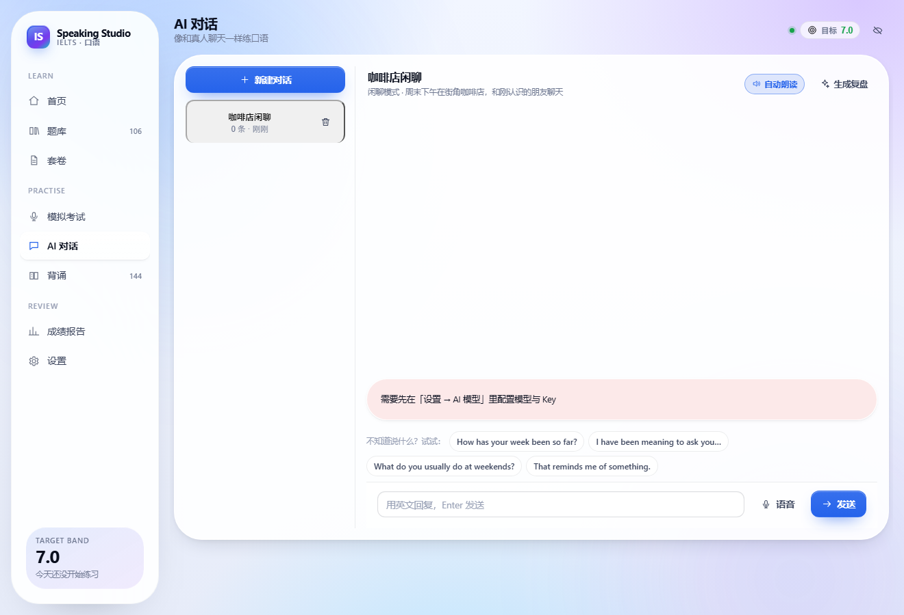
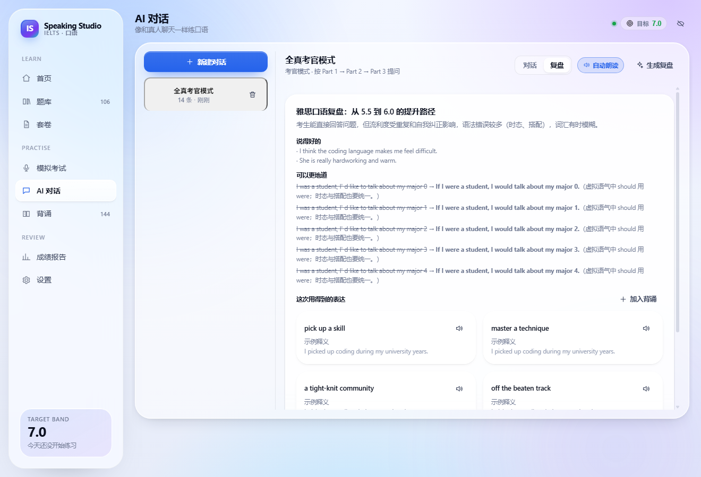

# IELTS Speaking Studio · 雅思口语工作台

[](https://github.com/kokosuki666/ielts-speaking-app-by-deepseek/actions/workflows/ci.yml)
[](https://github.com/kokosuki666/ielts-speaking-app-by-deepseek/releases)
[](LICENSE)

一个完全本地运行的雅思口语学习与练习工作台：**导入口语题库 → 自由组卷 → 限时模考 → AI 考官打分 → 话题词背诵 → 自由对话**，形成完整训练闭环。

- 本地题库支持 PDF / Word / Excel / JSON / CSV / 网页导入，也可让 AI 按话题出题
- AI 对话支持**语音输入、自动朗读、复盘标签页**；复盘不会再挤掉聊天记录
- 桌面版是**无边框窗口 + 自绘标题栏 + Windows 11 亚克力材质**，不再是原生菜单栏
- 语音转写可独立配置（聊天用 DeepSeek、转写用 SiliconFlow，互不影响）

界面采用「液态玻璃」风格（Apple 式排版 + 毛玻璃层次 + 柔和网格渐变），内置 **10 套主题背景**与可调节的毛玻璃参数，支持深色模式、自定义背景图与移动端底部导航。

> 当前版本 **v1.4.9**，更新内容见 [Releases](https://github.com/kokosuki666/ielts-speaking-app-by-deepseek/releases)。


---

## 下载与安装

| 包 | 适用 | 说明 |
| --- | --- | --- |
| **`IELTS-Speaking-Studio-1.4.9-x64.zip`** | 大多数用户 | **推荐**：解压即用，不经过 NSIS，不受临时目录影响 |
| `IELTS-Speaking-Studio-Setup-1.4.9.exe` | 想装到固定目录 | NSIS 安装版，会先解压约 660MB 到 `%TEMP%` |
| `IELTS-Speaking-Studio-1.4.9-portable.exe` | 临时使用 | 免安装单文件，同样依赖 `%TEMP%` |

下载地址：<https://github.com/kokosuki666/ielts-speaking-app-by-deepseek/releases>

**ZIP 版用法**

1. 下载后右键 → **全部解压缩**（不要在压缩包里直接双击 exe）
2. 解压后目录应包含 `resources\`、`locales\`、若干 DLL，约 **304 MB**
3. 双击 **`start.cmd`**（推荐）或 `IELTS Speaking Studio.exe`
4. 首次运行若提示「未知发布者」→ 更多信息 → 仍要运行

`start.cmd` 会清掉可能干扰 Electron 的 `ELECTRON_RUN_AS_NODE`、开启日志，并在退出时打印 `startup.log`。压缩包里还附带 `diagnose.cmd`，启动异常时可先运行它。

**数据位置**：`%APPDATA%\ielts-speaking-webapp`。换版本、换解压目录都不会丢；卸载 ZIP 版时删除程序目录即可，要彻底清数据再删这个目录。


## 功能

### 0. 外观与主题（设置 → 外观）

- **10 套主题背景**：液态玻璃、极光、日落、海岸、森林、樱花、紫霞、午夜、纸张、极简；切换时自动匹配浅色 / 深色
- **强调色**：10 个精选色，按钮、进度条、图表同步变化
- **毛玻璃参数**（实时生效、自动保存）：不透明度 12%–96%、模糊 0–60px、饱和度 80%–240%、边框高光 0–120%、圆角 8–36px
- **5 个质感预设**：液态玻璃 / 毛玻璃 / 水晶 / 浓玻璃 / 亚克力
- **开关**：毛玻璃按钮、胶片颗粒、背景缓动
- **实时预览卡片** + 一键毛玻璃 / 随机搭配 / 恢复默认
- **自定义背景图**：上传照片后自动压缩到 1600px，配合轻微模糊、白色/深色遮罩，保证正文可读
- **目标分快捷档位**：6.0 / 6.5 / 7.0 / 7.5 / 8.0 一键选择，也可用滑杆微调
- **桌面窗口**：无边框 + 自绘 34px 标题栏 + Windows 11 亚克力，移除原生菜单栏，整窗可拖动
- 全局 **6px 细滚动条**、卡片 hover 上浮、玻璃预设选中态

### 1. 本地题库与组卷

- 从本地导入 **PDF、Word(.docx)、Excel(.xlsx/.xls)、JSON、CSV、TSV、TXT、Markdown、HTML**，拖拽即可
- **从网址导入**：粘贴一个题库整理页 / 博客列表的 URL，抓取正文并识别题目
- **AI 出题**：按话题、Part、难度生成原创雅思风格题目，预览后作为一个新题库加入
- 文档在本地服务里提取文字，再用结构识别转成题目：识别 `Part 1/2/3`、话题标题、`Describe ...` 题卡与提示点、问句、中文翻译
- 自动识别字段别名（`question / prompt / 题目`、`topic / 话题`、`bullets / cue_points / 提示` 等）；支持 Excel 导出的 GBK 编码 CSV
- 按 Part、话题、标签、关键词筛选；勾选题目即可组卷
- 套卷结构 = Part 1 问答 + Part 2 Cue card + Part 3 讨论，自动估算时长
- 随机生成套卷（可设 Part 1 / Part 3 题量与话题范围）、复制、编辑、导出 JSON
- 内置一份当季高频题库：**106 道题，24 个话题**（14 个 Part 1 话题 × 4 题、10 张 cue card、40 道 Part 3）

### 2. AI 考官与评分系统

- 按雅思官方四项标准评分：**流利度与连贯性 / 词汇多样性 / 语法多样性与准确性 / 发音**
- 0.5 分步进；总分严格按官方规则取四项均值后四舍五入到 0.5
- 每项给出：分数、总评、优点、待改进、**逐句证据**（引用你的原话）+ 具体改法
- 可设置目标分数；报告自动计算分差，并给出：
  - 3 个按提分效率排序的训练重点 + 可执行动作
  - 目标分水平的高分示范改写（可朗读跟读）
  - 3–8 周的周计划
  - 这次最该背的话题词（一键加入背诵）
- 支持随时取消评分；AI 失败时自动降级到离线估算

**离线估算引擎（无需 API Key）**：基于语速（wpm）、填充词比例、实词多样性、复杂从句密度、句长分布、重复片段、高分表达命中率等可解释指标，给出偏保守的下限估计（±0.5 参考区间），并在报告中标注依据。

### 3. AI 对话

- 6 个日常场景（咖啡店闲聊、周末旅行、电影、工作、美食、科技）+ 任意自定义话题
- 也可切到「考官模式」，由 AI 按 Part 1 → Part 3 的梯度提问
- 流式回复、自动朗读开关、每条 AI 消息可单独朗读
- **语音输入**：输入框左侧「语音」按钮
  - 浏览器识别：Web Speech API（Chrome → Google，Edge → Microsoft）
  - 兼容接口转写：录音后走本地 `/api/asr` → SiliconFlow SenseVoice / OpenAI whisper
  - 开启「设置 → 语音 → 自动转写」后，转写完成会自动发送
- **复盘标签页**：生成复盘后自动切到「复盘」，内容独立滚动，可完整查看；切回「对话」时聊天记录原样保留
- 复盘内容：
  - 你说得好的表达（引用原句）
  - 2–4 条「你说 → 更地道」的改写与原因
  - **10–12 个口语化话题词**（含习语与话语标记），一键加入背诵

### 4. 背诵

- 内置 **12 个话题 × 12 条 = 144 张词卡**，全部为口语化表达（搭配 / 习语 / 短语 / 话语标记），含 IPA、中文释义、口语例句与译文
- **导入自己的词单**：PDF / Word / Excel / CSV / JSON / TXT / Markdown / HTML，也可以直接粘贴、粘贴网址或手动逐条添加；导入后作为一个独立词单出现在话题列表里，可整单删除
- 三种模式：翻转卡片复习、拼写自测（看中文写英文 + 例句挖空）、浏览词库
- 间隔重复（Leitner 5 盒，答对后间隔 1 → 2 → 4 → 7 → 15 → 30 天）
- 可基于题库话题用 AI 生成话题词：选话题 / 数量 / 难度，预览后加入词库（自动避开重复）
- **AI 生成入口**在背诵页顶部，和 1.3.0 的布局一致
- 到期仪表盘、开始复习 20 张、打乱顺序、本范围近期词条（点卡片听发音）
- 掌握度、到期数量、今日复习统计

### 5. 其他

- 首页：目标分进度、练习热力图（12 周）、分数趋势、最近成绩、下一步建议
- 全部数据存于浏览器 `localStorage`，支持整库导出 / 导入备份
- 打印样式：成绩报告可直接打印或另存 PDF
- 桌面版：无边框窗口、自绘标题栏、Win11 亚克力、窗口按钮（最小化 / 最大化 / 关闭）
- 内置 `start.cmd` / `diagnose.cmd`，方便排查启动问题

---

## 从源码运行

> 只想使用的话，直接看上面的「下载与安装」即可；本节面向开发与二次修改。

需要 Node.js ≥ 18（开发时使用 Node 24 验证）。

```bash
cd ielts-speaking-webapp
npm install
npm run dev
```

打开终端里 Vite 输出的地址（默认 <http://localhost:5199>）。`npm run dev` 会同时启动：

- 前端 Vite 开发服务器（配置里优先 5199，被占用时会自动换端口，以终端输出为准）
- 本地服务（<http://127.0.0.1:8787>）：AI 代理、文档解析（PDF / Word / Excel）、静态服务；前端通过 `/api` 代理访问

> PDF / Word / Excel 的导入依赖本地服务。只把 `dist/` 当纯静态页打开时，JSON / CSV / TXT 仍可导入，但不支持文档格式。

### 生产模式

```bash
npm run build
npm start          # 同一个端口同时提供静态页面与 /api，默认 http://127.0.0.1:8787
```

### 桌面版（Electron）

```bash
npm run desktop:dev     # 构建前端 + 用 Electron 打开
npm run desktop:build   # 构建 + 生成 Windows 安装包与便携版（输出到 release/）
```

产物：

- `release/IELTS Speaking Studio-Setup-1.4.9.exe`（NSIS 安装包）
- `release/IELTS Speaking Studio-1.4.9-portable.exe`（免安装单文件）
- `release/IELTS Speaking Studio-1.4.9-x64.zip`（免 NSIS 的 ZIP 便携版，解压即用）
- `release/win-unpacked/`（解包目录，便于排查）

> 版本号以 `package.json` 为准；发布时脚本会自动改这三处文件名。

桌面版主进程是 `electron/main.cjs`：启动时用当前 Node 拉起 `server/index.mjs`（端口 47119），再用窗口加载 `http://127.0.0.1:47119`，因此文档解析、AI 代理、神经语音全部可用，不依赖外部服务。

**安装包报 `NSIS Error: Error writing temporary file`？**

NSIS 运行时会先把自己解压到 `%TEMP%`（约 660MB），这一步失败就会弹这个框，和安装包完整性无关。任选一种：

1. 用 **ZIP 便携版**：解压到任意目录，双击 `IELTS Speaking Studio.exe`（最稳，不经过 NSIS）
2. 把临时目录指到可写位置后再运行：

   ```bat
   set TEMP=D:\temp&& set TMP=D:\temp&& start "" "IELTS Speaking Studio-Setup-1.4.9.exe"
   ```

3. 清理 `%TEMP%` 里的旧文件；确认 C 盘至少留有 2GB 空间

**双击 exe 没反应 / 没有窗口？**

1. 运行压缩包里的 **`diagnose.cmd`**（1.4.3 起随包提供），它会在控制台输出检查结果、smoke 启动日志和退出码
2. 或者手动执行：

   ```powershell
   cd "解压目录"
   $env:ELECTRON_ENABLE_LOGGING=1
   & ".\IELTS Speaking Studio.exe" --smoke
   echo "exit=$LASTEXITCODE"
   ```

3. 查看启动日志：`%APPDATA%\ielts-speaking-webapp\startup.log`（记录端口、服务启动、窗口创建、加载失败原因）
4. 常见原因：
   - 已经有一个实例在后台（单实例锁）→ 任务管理器结束所有 `IELTS Speaking Studio` 后重试
   - 没有完整解压（缺 `resources`）→ 重新解压整个 ZIP
   - 杀毒软件拦截了 `IELTS Speaking Studio.exe` → 加白名单

打包注意：

- 首次打包需要下载 Electron 与 NSIS 工具链；国内网络可设置镜像：
  `ELECTRON_MIRROR=https://npmmirror.com/mirrors/electron/`、
  `ELECTRON_BUILDER_BINARIES_MIRROR=https://npmmirror.com/mirrors/electron-builder-binaries/`
- 缓存默认写入 `%LOCALAPPDATA%\electron-builder`，若被安全软件拦截，可设置 `ELECTRON_BUILDER_CACHE=<项目内目录>`
- 未配置代码签名证书时会跳过签名（`electron-builder.yml` 里已显式关闭），Windows 可能提示"未知发布者"
- `electron-updater` 必须在 `dependencies` 里，否则打包后主进程会因找不到模块而闪退

### 源码备份

```bash
npm run backup            # 生成 git bundle 到 ..\ielts-speaking-backups
npm run backup -- D:\bak  # 指定目录
```

仓库已用 git 管理；建议每次改完提交一次，并定期把 bundle 放到另一块盘或网盘。

### 发布新版本（一条命令）

```bash
npm run release -- 1.4.9 "说明文字"
```

脚本 `scripts/release.mjs` 会依次完成：

1. 校验分支、工作区干净、版本号递增、标签不重复
2. 跑 `typecheck` + `build`
3. 改 `package.json` / `package-lock.json` 版本号并提交
4. 打标签 `v1.4.9`，推送 `main` 与标签
5. 创建 GitHub Release（自动生成说明）
6. 上传 `release/` 下的安装包，并生成 `SHA256SUMS.txt`

前提：

- 需要 `GITHUB_TOKEN`（repo 权限），或本机凭据管理器里已保存过 GitHub 凭据
- 国内网络可用 `--proxy http://127.0.0.1:7897`（或设置 `HTTPS_PROXY`）
- 先 `npm run desktop:build` 生成安装包；没有安装包时会只建 Release

常用参数：

```bash
npm run release -- 1.4.9 --dry-run    # 只检查并打印计划
npm run release -- 1.4.9 --no-push    # 提交打 tag，不推送
```

---


## 配置 AI

**项目里没有任何内置 Key，也不锁定模型。** 默认值只是把 DeepSeek 的地址和模型名填好，Key 留空——用不用、用哪家、花谁的钱，完全由你决定。

### 调用链

```
浏览器 (React) ──POST /api/ai/chat──▶ 本地服务 server/index.mjs ──▶ 你配置的 OpenAI 兼容接口 /chat/completions
```

- 前端只把「Base URL / 模型名 / 温度 / Key」和对话内容发给本地服务，从不直连模型：绕开 CORS，Key 也不会进入打包产物
- 本地服务按 OpenAI 规范转发；流式响应在服务端解析 SSE，再把纯文本分块转给前端
- 需要结构化输出的请求（评分报告、对话复盘、生成词条）会带 `response_format: json_object`；如果某个模型或网关不支持这个参数，服务端会**自动去掉它重试一次**，仍失败再**去掉 temperature** 重试，兼容性更好
- Key 解析顺序：设置页填的 Key → 同一提供商的 `.env` Key（仅当 Base URL 完全一致）→ 本地地址免 Key

### 换成任何模型

「设置 → AI 模型」里改三项即可，**保存后立即生效，不用重启**：

| 提供商 | Base URL | 模型名示例 |
| --- | --- | --- |
| DeepSeek | `https://api.deepseek.com/v1` | `deepseek-chat`、`deepseek-reasoner` |
| OpenAI | `https://api.openai.com/v1` | `gpt-4o-mini`、`gpt-4o` |
| Moonshot | `https://api.moonshot.cn/v1` | `moonshot-v1-8k` |
| 通义千问（兼容模式） | `https://dashscope.aliyuncs.com/compatible-mode/v1` | `qwen-plus` |
| 智谱 GLM | `https://open.bigmodel.cn/api/paas/v4` | `glm-4-flash` |
| SiliconFlow | `https://api.siliconflow.cn/v1` | `Qwen/Qwen2.5-7B-Instruct` |
| OpenRouter | `https://openrouter.ai/api/v1` | 任意模型 ID |
| 本机 Ollama | `http://127.0.0.1:11434/v1` | `qwen2.5:7b` |
| LM Studio / vLLM | `http://127.0.0.1:1234/v1` | 本地加载的模型名 |

本地地址（`localhost` / `127.0.0.1` / `0.0.0.0` / `host.docker.internal`）**可以不填 Key**，服务端会自动不带 `Authorization` 头。

### 三种存放 Key 的方式

1. **网站内设置**（推荐）：右上角「设置 → AI 模型」，填完点「测试连接」。Key 只存在本机浏览器 `localStorage`，不会上传到本项目的任何服务。
2. **`.env` 文件**：复制 `.env.example` 为 `.env` 并填写，服务端会读取：

   ```ini
   IELTS_AI_BASE_URL=https://api.deepseek.com/v1
   IELTS_AI_API_KEY=sk-xxxx
   IELTS_AI_MODEL=deepseek-chat
   ```

   然后在设置里打开「服务端密钥」，浏览器就完全不需要保存 Key（适合共用电脑）。

3. **环境变量**：直接设置 `IELTS_AI_BASE_URL / IELTS_AI_API_KEY / IELTS_AI_MODEL / PORT`。

> 为什么需要本地代理？浏览器直连大模型接口会被 CORS 拦截，而且把 Key 打进前端产物不安全。代理只有 `server/index.mjs` 一个文件。

### 哪些功能会调用模型

| 用 AI | 纯本地（无 Key 也能用） |
| --- | --- |
| 模考评分与报告（四项分数、证据、提分路径、示范答案） | 题库导入 / 组卷 / 模考录音与计时 |
| AI 对话、结束后的复盘与话题词 | 背诵（内置 144 张词卡 + 间隔重复） |
| AI 生成话题词条 | 离线估算评分（语速、填充词、词汇多样性等） |
| 「测试连接」 | 文档解析（PDF / Word / Excel） |

未配置 Key 时：模考仍可交卷，报告由离线估算引擎生成；AI 对话与 AI 生成词条会提示先配置。费用与配额由你自己的 Key 承担，录音和音频不会发送给模型，只有转写文本会。

---

## 题库导入格式

在「题库」页点击「导入口语题库」，可直接下载 CSV / JSON 模板。

### 支持的文件类型

| 类型 | 扩展名 | 处理方式 |
| --- | --- | --- |
| PDF | `.pdf` | 本地提取文字后做结构识别（需可复制文字，扫描件需先 OCR） |
| Word | `.docx` | 提取段落文字后做结构识别（旧版 `.doc` 请另存为 `.docx`） |
| Excel | `.xlsx` `.xls` | 读取所有工作表，按「表头 + 行」解析，等同于 CSV |
| JSON | `.json` | 直接解析（原生结构或松散结构） |
| 表格文本 | `.csv` `.tsv` | 自动识别分隔符与表头 |
| 纯文本 | `.txt` `.md` `.markdown` `.html` `.htm` | Markdown/HTML 先去标记，再按文档结构识别 |

PDF / Word / Excel 由本地 Node 服务（`server/index.mjs` + `unpdf` / `mammoth` / `xlsx`）解析，**文件不上传任何服务器**。因此需要用 `npm run dev` 或 `npm start` 启动应用；直接双击静态 `index.html` 时只有 JSON / CSV / 文本可用。

单文件上限 25 MB。

### 文档结构识别规则

以一份常见的 Word / PDF 题库为例：

```
IELTS Speaking Question Bank 2025

Part 1
Hometown
Where is your hometown?
你的家乡在哪里？
What do you like most about your hometown?

Part 2
Describe a person you admire.
You should say:
- who the person is
- how you know them
- what qualities they have
and explain why you admire them

Part 3
Why do people admire famous people?
```

导入后会得到 5 道 Part 1、1 张带 4 个提示点的 Part 2 cue card、1 道 Part 3。识别规则：

- `Part 1 / 2 / 3`、`Section 2`、`第二部分` 切换当前 Part
- `Describe ...` / `Talk about ...` 开启一张 cue card，其后到下一个问句之间的短句自动成为提示点（`You should say:` 会被忽略）
- 以 `?` / `？` 结尾，或以 What / Why / How / Do / Is / Should… 开头的行识别为题目
- 全中文行自动作为上一条题目的中文翻译；`Hometown 家乡` 这类行会拆成话题的中英文
- 短且不带标点的行视为话题标题（会过滤文档大标题、页码、页眉）
- 自动去重；被忽略的行数与「cue card 缺少提示点」等提示会显示在导入预览里

### JSON（推荐）

```json
{
  "name": "我的口语题库",
  "version": 1,
  "questions": [
    {
      "part": 1,
      "topic": "Hometown",
      "topicZh": "家乡",
      "question": "Where is your hometown?",
      "questionZh": "你的家乡在哪里？",
      "tags": ["高频"],
      "difficulty": 1
    },
    {
      "part": 2,
      "topic": "A person you admire",
      "topicZh": "你敬佩的人",
      "question": "Describe a person you admire.",
      "bullets": ["who the person is", "how you know them", "what qualities they have", "and explain why you admire them"],
      "tags": ["人物"],
      "difficulty": 2
    }
  ]
}
```

也接受更松散的写法：题目数组、按 Part 分组（`part1 / part2 / part3`）、按话题分组（`{ "Hometown": ["...", "..."] }`）。

### CSV / TSV

```csv
part,topic,topic_zh,question,question_zh,bullets,tags,difficulty
1,Hometown,家乡,Where is your hometown?,你的家乡在哪里?,,高频|基础,1
2,A person you admire,你敬佩的人,Describe a person you admire.,描述一个你敬佩的人。,who the person is|how you know them|what qualities they have|and explain why you admire them,人物|进阶,2
```

- `bullets` 用 `|` 或 `;` 分隔
- 无表头时按「第一列 = 题目，第二列 = 话题」解析
- 纯文本文件按「每行一题」解析，文件名即话题名
- 自动按题目文本去重

---

## 自定义词单（背诵）

「背诵 → 导入词单」支持四种入口：**文件 / 粘贴 / 网址 / 手动添加**。

- **文件**：PDF、Word(.docx)、Excel(.xlsx)、CSV、JSON、TXT、Markdown、HTML
- **粘贴**：直接贴文本，每行一条
- **网址**：抓取单个网页的正文并识别词条
- **手动添加**：逐条填词条、释义、例句、音标、所属词单

### 可识别的写法

JSON（数组，或按话题分组）：

```json
{
  "name": "我的旅行词单",
  "topics": {
    "Travel": [
      { "term": "off the beaten track", "meaningZh": "人迹罕至", "example": "We found a village off the beaten track." }
    ]
  }
}
```

表格（CSV / Excel，表头可用中文）：

```csv
term,meaning,example,phonetic,type,level
hit the nail on the head,一针见血,Your answer hit the nail on the head.,,idiom,8
wind down,放松,I wind down with a walk after work.,,phrase,7
```

纯文本（每行一条，支持多种分隔）：

```
serendipity - 意外发现珍奇事物的运气
hit the nail on the head - 一针见血
grab a bite | 随便吃点 | Let us grab a bite before the film.
resilience 韧性
```

- 字段别名同时支持英文与中文：`term / word / phrase / 单词 / 词组`、`meaning / 中文 / 释义`、`example / 例句`
- 没写 `type` 时按词条形态自动判断（单词 / 搭配 / 短语 / 话语标记），没写 `level` 默认 7 分档
- 按「话题 + 词条」去重；同一文件里带 `topic` 列的会拆成多个词单
- 导入后可在「浏览词库」里整单删除（内置词单不可删）

---

## 关于「自动更新题库 / 联网补充」

**没有做全自动抓取**，原因很实际：

- 雅思口语题库没有公开、稳定、可授权的官方数据源；流传的「当季题库」多为机构整理，直接抓取有版权与站点条款风险
- 网页结构经常变，自动解析会悄悄产出脏数据，比手动导入更麻烦
- AI 只能生成**原创练习题**，不能替代当季真题

所以提供的是三条**半自动**路径，安全可控：

1. **从网址导入**：你找到整理页，粘 URL 即可，只抓这一页，不遍历站点
2. **AI 出题**：按话题 + Part + 难度生成新题，预览后作为一个新题库加入；适合补充 Part 2 题卡和 Part 3 追问
3. **AI 生成话题词**：基于已有话题补充 6–16 个口语化表达

如果你确实需要自动更新，可行做法是：自己维护一个 `manifest.json`（题库版本 + 下载地址），应用启动时检查并提示更新——这需要你有一个稳定的托管位置。需要的话可以加，但不建议接第三方站点爬虫。

---

## 评分标准与实现说明

- 分数区间 3.5–9.0，0.5 步进；总分 = 四项均值 → 四舍五入到最近的 0.5（官方规则）
- 提示词内嵌了公开的 band descriptor 摘要（5/6/7/8/9），并要求 AI：不得虚高、必须引用原话、每个弱点配具体改法
- 发音项确实需要音频才能严谨判断；AI 模式下由文本与流利度证据推断，报告中会明确说明，建议录音回放自查

## 浏览器支持

| 功能 | Chrome / Edge | Safari | Firefox |
| --- | --- | --- | --- |
| 题库 / 组卷 / 背诵 / 报告 | ✅ | ✅ | ✅ |
| 语音合成（朗读） | ✅ | ✅ | ✅ |
| 浏览器语音识别 | ✅（Chrome→Google / Edge→Microsoft） | ⚠️ 部分版本 | ❌ |
| 云端转写（SiliconFlow / whisper） | ✅ | ✅ | ✅ |
| 麦克风录音回放 | ✅ | ✅ | ✅ |

不支持语音识别时，可直接用键盘输入作答文本，评分照常进行。

## 语音（朗读）说明

朗读有三种引擎，在「设置 → 语音」里切换：

| 引擎 | 音质 | 需要 Key | 需要联网 | 说明 |
| --- | --- | --- | --- | --- |
| **Edge 神经音色**（默认） | ★★★★★ 接近真人 | ❌ 免费 | ✅ | 微软 Edge「大声朗读」同一套神经网络音色（Ava / Andrew / Emma / Sonia…），由本地服务负责合成 |
| OpenAI 兼容 TTS | ★★★★ | ✅ 用你的 TTS 额度 | ✅ | 走 `POST /audio/speech`，支持 OpenAI `tts-1` / `gpt-4o-mini-tts`、SiliconFlow CosyVoice 等 |
| 系统音色（离线） | ★★ 较机械 | ❌ | ❌ | 浏览器 Web Speech API，调用 Windows SAPI 语音，完全离线 |

默认用 Edge 神经音色，**默认音色是 Ava（多语自然女声）**，也可以在设置里换 Andrew / Emma / Sonia。实现要点（`src/lib/speech.ts`、`src/lib/ttsText.ts`、`server/index.mjs`）：

- **朗读前清洗文本**：去掉双引号 / 弯引号 / Markdown / 箭头 / 括号，`&` 读作 and，`e.g.` 展开为 for example，避免 TTS 把符号或“quote”念出来
- **服务端 XML 转义**：`& < >` 不转义会让 Edge 收到非法 XML 并直接断流，这是之前偶发“合成失败”的根因
- **不重复加速**：以前合成时应用一次语速、播放时 `playbackRate` 又应用一次；现在云端只合成一次，声音不再被拉慢/拉扁
- **音高微调**：Edge 合成加入 `pitch -2Hz`，减少机械感
- **标点停顿**：Edge 免费端点不接受 SSML `<break>`（会断流），因此停顿依赖句读与标点，而不是强制插入标签
- **服务端合成 + 缓存**：`POST /api/tts` 返回 MP3；同一句话第二次直接命中内存缓存（约 5ms）
- **连接复用**：Edge 的 WebSocket 握手约 1 秒，服务端按音色池化复用，热态首次合成约 300–500ms
- **串行 + 退避重试**：微软接口对突发请求会返回 429，服务端把合成请求排队、保持 250ms 间隔，并对 429 做 1s/2s 退避重试
- **自动降级**：云端音色失败（断网、被限流、服务没启动）会自动改用系统音色继续读，并提示一次，不会静默无声
- **预热**：背诵卡片切换时预取该词条的音频，点喇叭几乎立即出声
- **系统音色兜底**：本地音色优先，避开需要访问 Google 的在线音色；同时修掉了 Chrome 里 `cancel()` + `speak()` 同任务调用吞掉语音的问题

如果没声音或音质不对：

1. 设置 → 语音 → 点「测试朗读」，看状态（正在播放 / 失败原因）；
2. 「Edge 神经音色」需要本地服务运行（`npm run dev` 或 `npm start`），纯静态打开时会自动退回系统音色；
3. 播放中但听不到 → 检查 Windows 音量、输出设备、标签页是否被静音；
4. 想更自然 → 音色选 **Ava**，语速调到 **0.95** 左右；英式口音选 Sonia / Ryan，美式男声选 Andrew；
5. 有 OpenAI / SiliconFlow 的 Key → 选「OpenAI 兼容 TTS」，模型填 `tts-1` 或 `gpt-4o-mini-tts`，音色填 `alloy` / `nova` 等。

> Edge 神经音色走的是微软 Read Aloud 的公开接口，不是官方付费 API，可能随微软策略变化或限流；测试中也遇到过连接超时，出现问题时切到 OpenAI TTS 或系统音色即可。

### 语音识别（语音转文字）

模考和 AI 对话里的转写有两条通道，在「设置 → 语音识别」切换：

| 方式 | 原理 | 适用 |
| --- | --- | --- |
| 浏览器识别 | Web Speech API：Chrome 把音频发往 **Google 服务器**，Edge 走 Microsoft | 能访问 Google 时最快；国内通常不可用 |
| 兼容接口转写 | 录音后上传到本地服务，转发给 `/audio/transcriptions`（OpenAI whisper-1、SiliconFlow SenseVoice 等） | **国内推荐**；可独立配置 Base URL / Key，留空则复用「AI 模型」 |

**最快配置（推荐 SiliconFlow）**

1. 设置 → 语音识别 → 识别方式选 **兼容接口转写**
2. 点快速配置里的 **SiliconFlow**
3. 填入硅基流动的 Key（<https://cloud.siliconflow.cn> → API 密钥）
4. 确认下方显示：`https://api.siliconflow.cn/v1/audio/transcriptions`

| 服务 | Base URL | 模型 |
| --- | --- | --- |
| SiliconFlow | `https://api.siliconflow.cn/v1` | `FunAudioLLM/SenseVoiceSmall` |
| OpenAI | `https://api.openai.com/v1` | `whisper-1` |
| 本机 whisper | `http://127.0.0.1:8000/v1` | `whisper-1` |

「独立 Base URL / Key」留空时会复用 AI 配置，所以可以**聊天用 DeepSeek、转写用 SiliconFlow**；如果聊天本身就是 SiliconFlow，Key 可以留空复用。

**转写报 404？**

- 最常见原因：ASR 的 Base URL 留空，回退到了 DeepSeek —— DeepSeek 没有 `/audio/transcriptions`
- 其次：Base URL 少写 `/v1`，或把完整端点（`.../v1/audio/transcriptions`）填进了 Base URL
- 1.4.8 起会自动去掉误填的端点、给 openai.com / siliconflow.cn 补 `/v1`；如果仍在复用 DeepSeek，点语音时会直接提示去配 SiliconFlow
- 错误信息会附带实际请求地址，按地址检查即可

**“需要联网”但网是通的？**

Chrome 的语音识别不是本地识别，音频要送到 Google 的语音服务；国内网络到不了那台服务器，于是返回 `network` 错误。这不是断网，也不是麦克风问题。解决办法：用 **Edge** 打开应用，或改用上面的 SiliconFlow 云端转写。

开启「设置 → 语音 → 自动转写」后，录音结束会自动转写并发送，接近语音对话。

## 隐私

- 题库、作答、成绩、词卡、聊天记录全部保存在本机浏览器（桌面版在 `%APPDATA%\ielts-speaking-webapp`）
- 只有当你配置了 AI 并主动触发评分 / 对话 / 出题时，相关文本才会发送到你指定的模型服务
- **浏览器识别**：音频由浏览器直接发往 Google / Microsoft 的语音服务
- **兼容接口转写**：音频经本地服务转发给你配置的 ASR 服务（如 SiliconFlow）；如果配的是本机 whisper，音频不出本机
- 项目没有统计、埋点或远程日志；API Key 只存在本机，不会进入打包产物

## 稳定性与断线恢复

本地服务需要长时间开着，所以做了这些防护：

- **`npm run dev` 是守护进程**（`scripts/dev.mjs`）：本地服务与 Vite 各自独立启动，任意一个崩溃会在 0.4–5 秒内自动重启，**不会把另一个一起关掉**。连续 6 次失败才停止重试并打印原因。
- **端口占用不再无限重启**：本地服务检测到 `EADDRINUSE` 时以退出码 78 退出，启动器直接给出占用排查命令（`netstat -ano | findstr :8787` / `taskkill /F /PID <PID> /T`），不会刷屏重试。
- **进程级容错**：未捕获异常、未处理的 Promise 拒绝只会记录日志，不再让服务进程退出（长连接、上游 WebSocket 抖动不再致命）。
- **HTTP keep-alive 调长到 120 秒**：页面空闲一段时间后，第一个请求不会偶发 `ECONNRESET`。
- **语音合成连接复用**：按音色池化复用 WebSocket，空闲 2 分钟回收；遇到微软接口 429 自动退避重试，失败才降级到系统音色。
- **页面有连接状态点**（右上角）：绿色＝本地服务正常，红色＝已断开；断开时顶部出现「正在自动重连…」，服务恢复后自动变绿并提示「已重新连接」，**不需要刷新页面**。
- **Ctrl+C 干净退出**：Windows 下用 `taskkill /T` 结束整个进程树，不会残留占用 8787 / 5199 的孤儿进程。

### 安全边界

- 本地服务只监听 `127.0.0.1`，不对外网开放
- `/api/*` 会校验 `Origin` / `Sec-Fetch-Site`，**拒绝其他网站的跨站调用**（否则任意网页都能借你的本地代理消耗 Key、探测内网）
- 请求体有上限：TTS 文本 1200 字、文档解析 25MB、网页抓取 5MB（流式读取，超限立即中断）、音频转写 30MB
- 静态服务只暴露 `dist/`，路径穿越会回落到 `index.html`，不会读到源码
- Electron：`contextIsolation` / `sandbox` 开启、`nodeIntegration` 关闭、站外链接交给系统浏览器

API Key 保存在浏览器 `localStorage`（桌面版存在应用数据目录），不会上传；但仍建议只在个人设备上使用。

如果曾经用任务管理器强制结束过进程、导致端口被占：按启动器打印的 `taskkill` 命令清理一次即可，或重启终端。

## 目录结构

```
ielts-speaking-webapp/
├─ server/index.mjs          # 本地 AI 代理 + 文档解析 + Edge/OpenAI TTS + /api/asr 转写 + 静态服务
├─ electron/                 # 无边框窗口、自绘标题栏、更新与备份 IPC
├─ scripts/
│  ├─ dev.mjs                # 同时起前端与本地服务，崩溃自动重启
│  └─ release.mjs            # 一条命令：改版本 → 构建 → 提交 → 打 tag → 建 Release → 上传资产
├─ tools/                    # start.cmd / diagnose.cmd（随桌面包分发）
├─ src/
│  ├─ pages/                 # Home / Library / Papers / Builder / Exam / Reports / Chat / Vocab / Settings
│  ├─ components/            # 设计系统与基础组件（Icon / ui / 外观面板）
│  ├─ lib/
│  │  ├─ appearance.ts       # 10 套主题、毛玻璃变量、自定义背景
│  │  ├─ ai.ts / prompts.ts  # 模型调用与评分 / 对话 / 出题 / 复盘提示词
│  │  ├─ asr.ts              # 语音转写、Base URL 规范化、独立 ASR 配置
│  │  ├─ speech.ts           # TTS 引擎、缓存、降级
│  │  ├─ ttsText.ts          # 朗读文本清洗（去引号/Markdown/符号）
│  │  ├─ importBank.ts       # 题库导入：JSON / 表格 / 文档 / 网页
│  │  └─ srs.ts              # Leitner 间隔重复
│  ├─ store/useApp.ts        # zustand + localStorage 持久化
│  ├─ data/                  # 内置题库与词库（106 题 / 144 词）
│  └─ styles.css             # 液态玻璃设计系统
└─ docs/                     # 界面截图
```

## 已知限制

- 离线评分是**启发式估算**，用于没有 Key 时给出方向性反馈，不等同于真实考官评分
- 浏览器语音识别依赖 Google / Microsoft 的在线服务，国内网络下 Chrome 通常不可用
- 云端转写需要你自己的 ASR Key，费用由对应平台计算
- Edge 神经音色走微软免费公开接口，可能限流或连接超时；失败会自动降级为系统音色
- 单次模考录音只保留当前会话（刷新后录音不可回放，转写文本会保留在报告中）
- 数据存放在浏览器，清理站点数据会丢失；请定期在「设置」里导出备份
- **扫描版（图片型）PDF 无法提取文字**，需先 OCR；导入时会提示「没有提取到文字」
- 旧版 `.doc` / `.ppt` 不支持，请在 Office 里另存为 `.docx` / 导出 PDF
- 文档结构识别是启发式的：版式特别复杂（多栏、表格混排、答案与题目混在一起）时，建议用 CSV/JSON 模板，或导入后在题库里少量手动修正

## 更新记录

| 版本 | 主要变化 |
| --- | --- |
| **v1.4.9** | 复盘改为「对话 / 复盘」双标签、独立滚动；语音清洗引号与符号、修复 `&` 导致 Edge 断流、去掉重复语速、默认 Ava 音色 |
| v1.4.8 | ASR Base URL 规范化、SiliconFlow/OpenAI/本机 whisper 快速配置、404 可操作提示 |
| v1.4.7 | AI 对话语音输入与自动朗读；修复外观滑杆（不透明度钳制、边框高光） |
| v1.4.6 | 补回 `.mesh` 背景层，10 套主题真正生效；修复自定义背景与「一键毛玻璃」按钮变白 |
| v1.4.5 | 桌面无边框窗口、自绘标题栏、Win11 亚克力、柔化卡片描边 |
| v1.4.4 | 背诵页对齐 1.3.0：AI 生成话题词、复习仪表盘、20 张批量；对话场景卡；自定义背景 |
| v1.4.3 | 修复桌面启动无窗口：图标缺失兜底、启动日志、8 秒窗口兜底、diagnose.cmd |

完整说明见 [Releases](https://github.com/kokosuki666/ielts-speaking-app-by-deepseek/releases)。

## 截图

| 首页 | 背诵 |
| --- | --- |
|  |  |

| 设置（主题与自定义背景） | AI 对话（语音输入） |
| --- | --- |
|  |  |

| 复盘标签页 | 桌面标题栏 |
| --- | --- |
|  |  |

